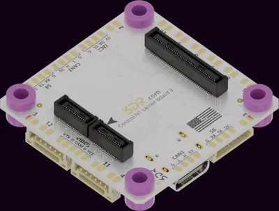

.. _3dr_n1_fpv:

3DR Control N1 Carrier 3 (FPV)
##############################

Overview
********

The Control N1 Carrier 3 (FPV, R0033) is a carrier board for the :zephyr:board:`control_n1`
flight controller module, with 30.5 mm x 30.5 mm M3 mounting holes that fit 4-in-1 ESC and power
distribution board stacks. It runs from a 3S to 8S battery (6.4 V to 36 V), supplies 5 V to the
peripherals, brings the module interfaces out to JST-GH ports, solder pads, an 8-pin JST-SH ESC
connector and a USB-C receptacle, and carries an on-screen display (OSD) for analog video
transmitters.

   3DR Control N1 Carrier 3 (FPV) (Credit: 3DR)

More information about the board can be found in the `FPV carrier documentation`_.

Pins Assignment
***************

The TELEM-style serial ports SG1 to SG3 and the GPS1 port follow the `Pixhawk Connector Standard`_
and carry the matching ``pixhawk_*`` node labels described in :ref:`shield-interfaces`. The other
ports use the node labels of the Control N1 board.

+-------+--------------------------------+------------------+----------------------------------+
| Port  | Pins                           | Interface        | Node labels                      |
+=======+================================+==================+==================================+
| GPS1  | 5V, TX, RX, SCL, SDA, GND      | SG7, I2C1        | ``pixhawk_gps1_connector``,      |
|       |                                |                  | ``pixhawk_gps1_serial``,         |
|       |                                |                  | ``pixhawk_gps1_i2c``             |
+-------+--------------------------------+------------------+----------------------------------+
| SG1   | 5V, TX, RX, CTS, RTS, GND      | SG1              | ``pixhawk_telem1_connector``,    |
|       |                                |                  | ``pixhawk_telem1``               |
+-------+--------------------------------+------------------+----------------------------------+
| SG2   | 5V, TX, RX, CTS, RTS, GND      | SG2              | ``pixhawk_telem2_connector``,    |
|       |                                |                  | ``pixhawk_telem2``               |
+-------+--------------------------------+------------------+----------------------------------+
| SG3   | 5V, TX, RX, CTS, RTS, GND      | SG3 (console)    | ``pixhawk_telem3_connector``,    |
|       |                                |                  | ``pixhawk_telem3``               |
+-------+--------------------------------+------------------+----------------------------------+
| ESC   | VBAT, GND, CH1 to CH4, NC, NC  | CH1 to CH4       | ``cn1_pwm``                      |
+-------+--------------------------------+------------------+----------------------------------+
| SG4   | Pads                           | SG4              | ``cn1_sg4_serial``               |
+-------+--------------------------------+------------------+----------------------------------+
| SG6   | Pads                           | SG6              | ``cn1_sg6_serial``               |
+-------+--------------------------------+------------------+----------------------------------+
| I2C2  | Pads                           | I2C2             | ``cn1_i2c2``                     |
+-------+--------------------------------+------------------+----------------------------------+
| CAN1  | Pads                           | FDCAN1           | ``cn1_can1``                     |
+-------+--------------------------------+------------------+----------------------------------+
| CAN2  | Pads                           | FDCAN2           | ``cn1_can2``                     |
+-------+--------------------------------+------------------+----------------------------------+
| PWM   | Pads                           | CH1 to CH12      | ``cn1_pwm``                      |
+-------+--------------------------------+------------------+----------------------------------+
| USB   | USB-C                          | USB              | ``zephyr_udc0``                  |
+-------+--------------------------------+------------------+----------------------------------+

The ESC connector and the PWM pads 1 to 4 carry the same outputs: use only one of them. The battery
input is on the VBATT pads. The OSD and its video pads are not described, as the OSD interface to
the module is not documented.

Hardware flow control is off by default on SG1 to SG3. Enable it with an overlay:

.. code-block:: devicetree

   &pixhawk_telem1 {
       hw-flow-control;
   };

Programming
***********

Set ``--shield 3dr_n1_fpv`` when you invoke ``west build``. For example:

.. zephyr-app-commands::
   :zephyr-app: samples/hello_world
   :board: control_n1
   :shield: 3dr_n1_fpv
   :goals: build flash

The Zephyr console is on SG3 at 115200 baud. ``west flash`` uploads the application through the
module bootloader over the USB-C receptacle.

References
**********

.. target-notes::

.. _FPV carrier documentation:
   https://docs.3dr.com/autopilots/carrier-boards/r0033-cb3-fpv/

.. _Pixhawk Connector Standard:
   https://github.com/pixhawk/Pixhawk-Standards
