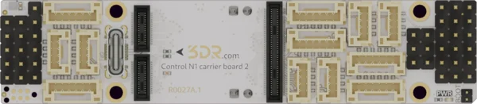

.. _3dr_n1_longy:

3DR Control N1 Carrier 2 (Longy)
################################

Overview
********

The Control N1 Carrier 2, nicknamed Longy (R0027), is an 87 mm x 19 mm carrier board for the
:zephyr:board:`control_n1` flight controller module. It supplies the module and its peripherals
from a single 5 V input and brings the module interfaces out to JST-GH ports, a USB-C receptacle
and servo headers.

   3DR Control N1 Carrier 2 (Longy) (Credit: 3DR)

More information about the board can be found in the `Longy documentation`_.

Pins Assignment
***************

The TELEM-style serial ports SG1 to SG3, the GPS ports, the I2C port and the CAN ports follow the
`Pixhawk Connector Standard`_ and carry the matching ``pixhawk_*`` node labels described in
:ref:`shield-interfaces`. The other ports use the node labels of the Control N1 board.

+-------+--------------------------------+------------------+----------------------------------+
| Port  | Pins                           | Interface        | Node labels                      |
+=======+================================+==================+==================================+
| GPS1  | 5V, TX, RX, SCL, SDA, GND      | SG7, I2C1        | ``pixhawk_gps1_connector``,      |
|       |                                |                  | ``pixhawk_gps1_serial``,         |
|       |                                |                  | ``pixhawk_gps1_i2c``             |
+-------+--------------------------------+------------------+----------------------------------+
| GPS2  | 5V, TX, RX, SCL, SDA, GND      | SG4, I2C2        | ``pixhawk_gps2_connector``,      |
|       |                                |                  | ``pixhawk_gps2_serial``,         |
|       |                                |                  | ``pixhawk_gps2_i2c``             |
+-------+--------------------------------+------------------+----------------------------------+
| SG1   | 5V, TX, RX, CTS, RTS, GND      | SG1              | ``pixhawk_telem1_connector``,    |
|       |                                |                  | ``pixhawk_telem1``               |
+-------+--------------------------------+------------------+----------------------------------+
| SG2   | 5V, TX, RX, CTS, RTS, GND      | SG2              | ``pixhawk_telem2_connector``,    |
|       |                                |                  | ``pixhawk_telem2``               |
+-------+--------------------------------+------------------+----------------------------------+
| SG3   | 5V, TX, RX, CTS, RTS, GND      | SG3 (console)    | ``pixhawk_telem3_connector``,    |
|       |                                |                  | ``pixhawk_telem3``               |
+-------+--------------------------------+------------------+----------------------------------+
| SG5   | 5V, TX, RX, GND                | SG5              | ``cn1_sg5_serial``               |
+-------+--------------------------------+------------------+----------------------------------+
| SG6   | 5V, TX, RX, GND                | SG6              | ``cn1_sg6_serial``               |
+-------+--------------------------------+------------------+----------------------------------+
| I2C2  | 5V, SCL, SDA, GND              | I2C2             | ``pixhawk_i2c2_connector``,      |
|       |                                |                  | ``pixhawk_i2c2``                 |
+-------+--------------------------------+------------------+----------------------------------+
| CAN1  | 5V, CAN_H, CAN_L, GND          | FDCAN1           | ``pixhawk_can1``                 |
+-------+--------------------------------+------------------+----------------------------------+
| CAN2  | 5V, CAN_H, CAN_L, GND          | FDCAN2           | ``pixhawk_can2``                 |
+-------+--------------------------------+------------------+----------------------------------+
| SPI   | 5V, SCK, MISO, MOSI, CS, GND   | SPI              | ``cn1_spi``                      |
+-------+--------------------------------+------------------+----------------------------------+
| PWR   | 5V, ADC1, ADC2, GND            | ADC1, ADC2       | ``cn1_adc``                      |
+-------+--------------------------------+------------------+----------------------------------+
| Servo | 12 outputs                     | CH1 to CH12      | ``cn1_pwm``                      |
+-------+--------------------------------+------------------+----------------------------------+
| USB   | USB-C                          | USB              | ``zephyr_udc0``                  |
+-------+--------------------------------+------------------+----------------------------------+
| SWD   | 5V, SWDIO, RST, SWCLK, GND, NC | SWD              |                                  |
+-------+--------------------------------+------------------+----------------------------------+

GPS2 and I2C2 share the I2C2 bus. The ADC1 and ADC2 inputs are also available on single-pin
headers, and BOOT0 on a two-pin header next to 3V3. The three IO pins of the board are not
described yet, as their MCU pins are not documented.

Hardware flow control is off by default on SG1 to SG3. Enable it with an overlay:

.. code-block:: devicetree

   &pixhawk_telem1 {
       hw-flow-control;
   };

Programming
***********

Set ``--shield 3dr_n1_longy`` when you invoke ``west build``. For example:

.. zephyr-app-commands::
   :zephyr-app: samples/hello_world
   :board: control_n1
   :shield: 3dr_n1_longy
   :goals: build flash

The Zephyr console is on SG3 at 115200 baud. ``west flash`` uploads the application through the
module bootloader over the USB-C receptacle. The SWD port, compatible with Tag-Connect TC2030
cables, is available for debugging and for the ``bare`` variant of the board.

References
**********

.. target-notes::

.. _Longy documentation:
   https://docs.3dr.com/autopilots/carrier-boards/r0027-cb2-longy/

.. _Pixhawk Connector Standard:
   https://github.com/pixhawk/Pixhawk-Standards
